

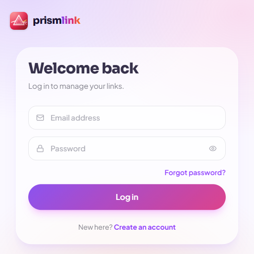

# PrismLink

**One link. Every side of you.**

A beautiful link-in-bio platform. Collect your socials, music, videos and projects on a single, colourful page — styled your way and shared with one short URL.

---

## Screenshots

### Desktop

<table>
  <tr>
    <td>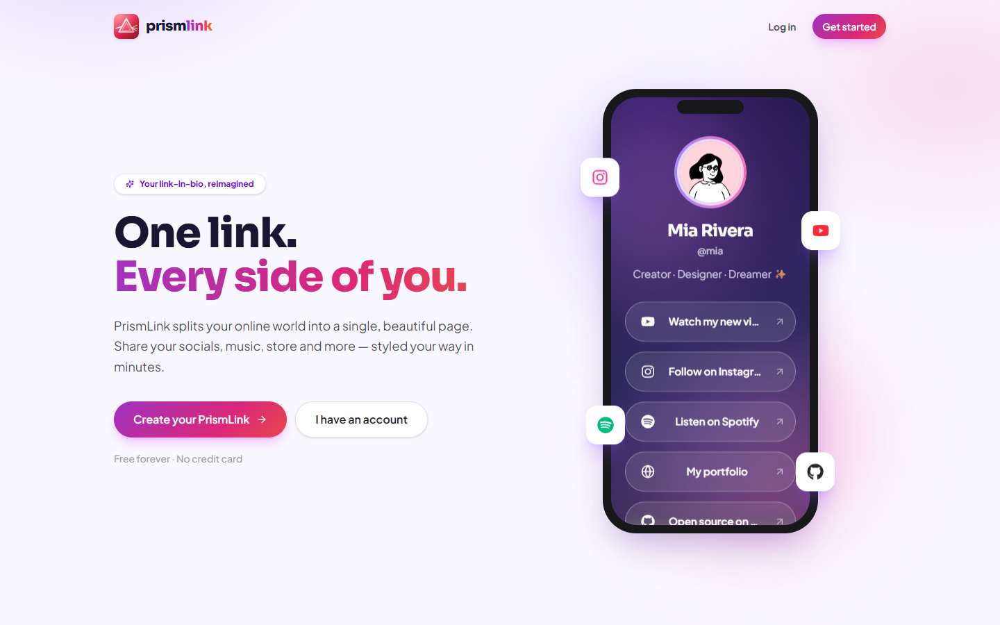</td>
    <td>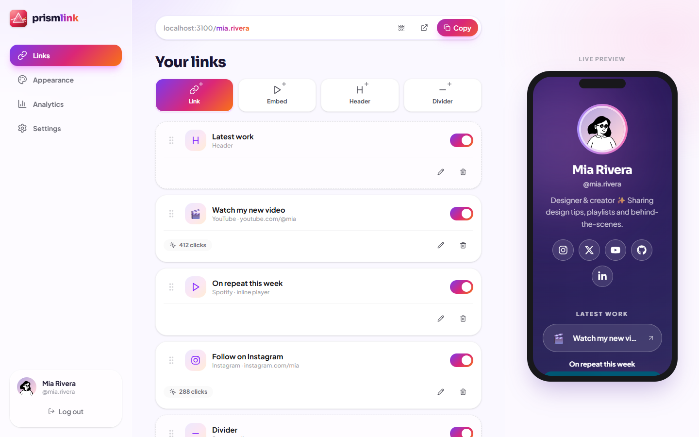</td>
  </tr>
  <tr>
    <td align="center">Landing page</td>
    <td align="center">Dashboard with live phone preview</td>
  </tr>
  <tr>
    <td>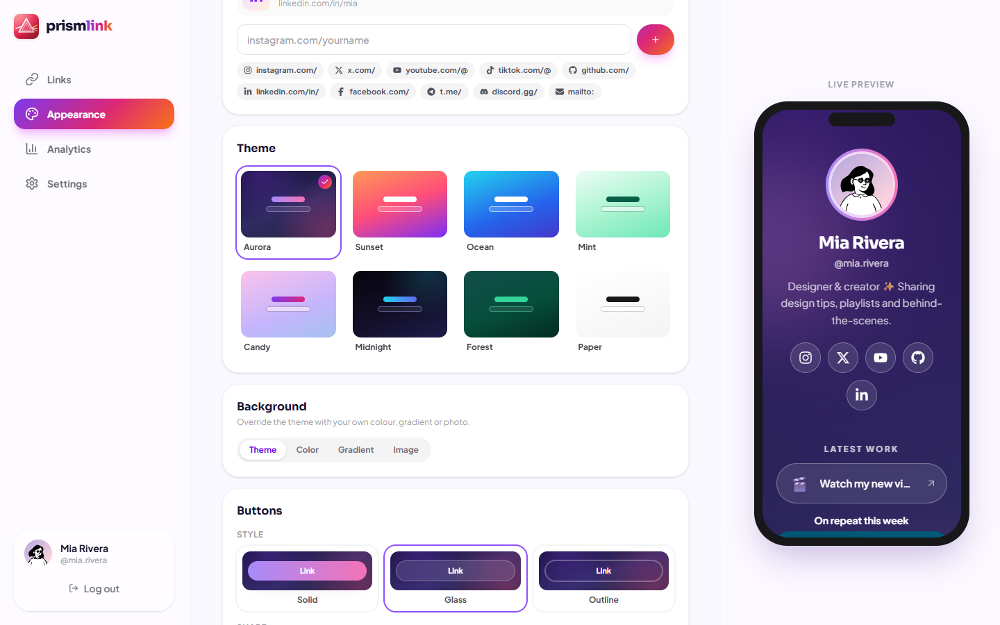</td>
    <td>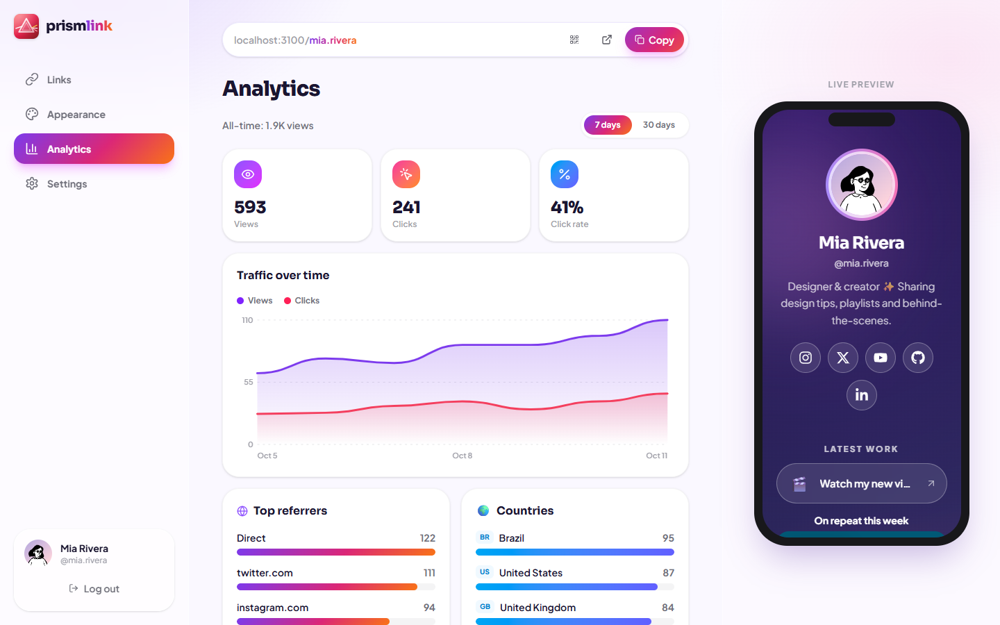</td>
  </tr>
  <tr>
    <td align="center">Themes, backgrounds and button styles</td>
    <td align="center">Analytics</td>
  </tr>
  <tr>
    <td colspan="2">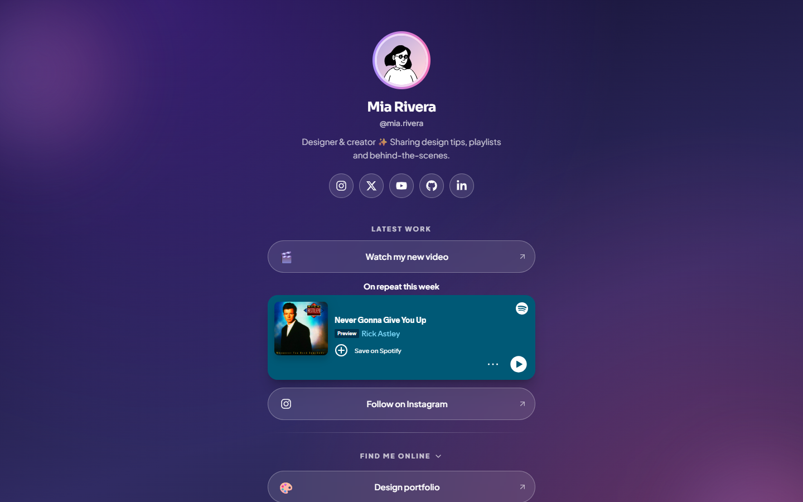</td>
  </tr>
  <tr>
    <td colspan="2" align="center">A public profile page</td>
  </tr>
</table>

### Mobile

<table>
  <tr>
    <td>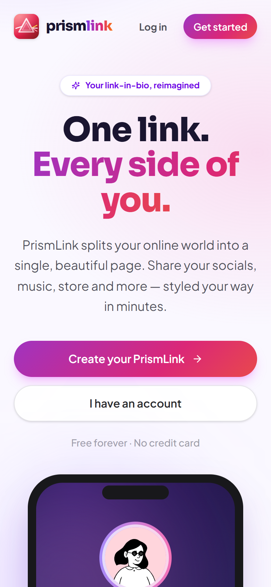</td>
    <td>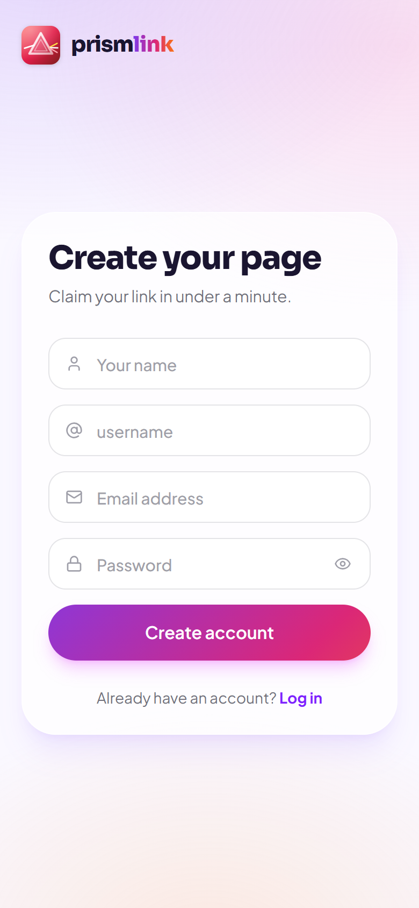</td>
    <td>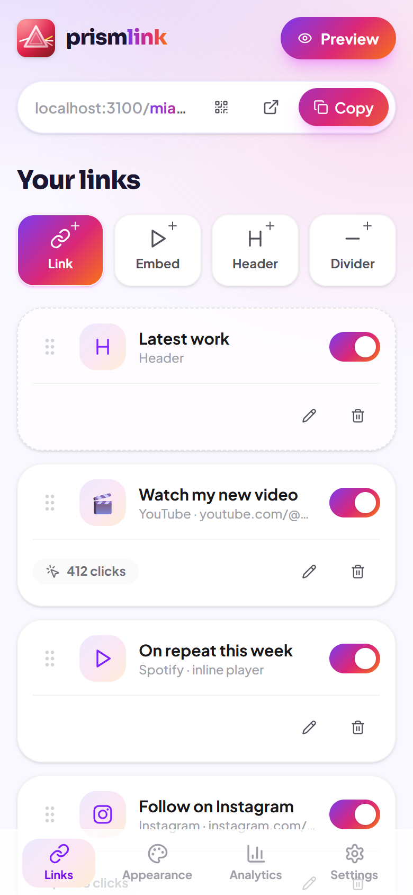</td>
  </tr>
  <tr>
    <td align="center">Landing</td>
    <td align="center">Sign up</td>
    <td align="center">Dashboard</td>
  </tr>
  <tr>
    <td>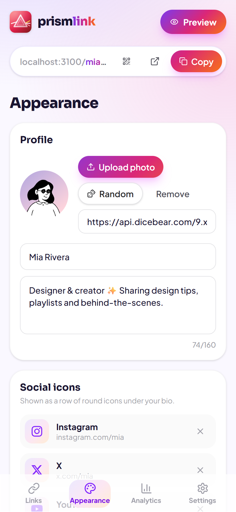</td>
    <td>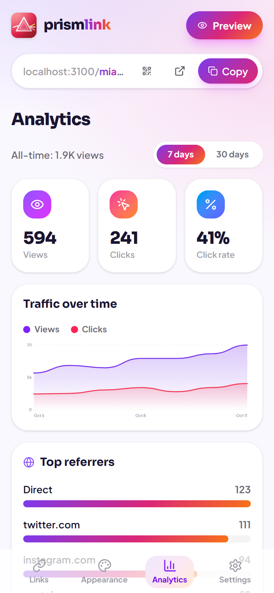</td>
    <td>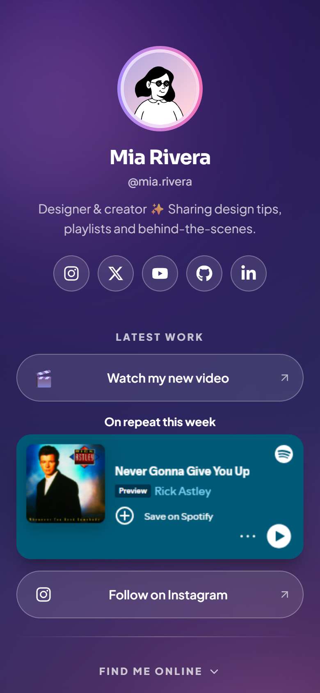</td>
  </tr>
  <tr>
    <td align="center">Appearance</td>
    <td align="center">Analytics</td>
    <td align="center">Public profile</td>
  </tr>
</table>

---

## About

PrismLink turns a single link into a home for everything you share online. Sign up, claim a username, add your links, pick a theme and share `yourdomain/username` anywhere — your bio, your videos, your business card.

The interface adapts to the device. On a phone it feels like a native app, with a bottom tab bar and a full-screen preview. On desktop it becomes a full studio with a sidebar, an editor and a live phone preview that updates as you type.

## Features

- **Email & password authentication** — sign up, log in and reset your password.
- **Unique usernames** — claim your own page and change the name later.
- **Links, groups, headings, dividers and embeds** — build your page from five kinds of blocks.
- **Link groups** — put related links into a named group that shows as a framed panel on your page; groups can be collapsible so visitors can fold them open and closed.
- **Drag & drop** — reorder anything with a flick, on mouse or touch. Drag links between groups, pull them back out to the top level, or move a whole group as one block.
- **Custom card gradients** — give any link its own gradient, set a default for a whole group, or colour every card at once. Pick from 12 presets or choose your own two colours; text colour adjusts automatically for contrast.
- **Show / hide toggle** — switch any block on or off instantly.
- **Social icon row** — Instagram, X, YouTube, GitHub, LinkedIn and more as round icons under your bio.
- **Smart icons** — the platform icon is detected from the URL, or choose an emoji or your own image for each link.
- **Inline players** — YouTube, Spotify and SoundCloud play right on your page.
- **Scheduled links** — set a start and end time; links appear and expire on their own, with an "Ends in…" countdown for visitors.
- **8 gradient themes** — Aurora, Sunset, Ocean, Mint, Candy, Midnight, Forest and Paper.
- **Custom backgrounds** — your own colour, a two-colour gradient or an uploaded photo with an adjustable dark overlay. Text colour adjusts automatically for readability.
- **Button styles and shapes** — solid, glass or outline buttons in pill, rounded or square shapes.
- **Profile photo upload** — or generate a random avatar.
- **Live preview** — see every change instantly in a phone mockup.
- **Analytics** — views, clicks and click rate over 7 or 30 days, with an interactive chart, top referrers, countries, devices and top links.
- **Share tools** — one-tap copy, open page and a scannable QR code.
- **Smooth animations** — spring transitions, staggered link entrances and animated charts throughout.
- **Fully responsive** — mobile-app experience on phones, studio layout on desktop.

## How it works

| Area | What you can do |
| --- | --- |
| **Create** | Add links, groups, embeds, headings and dividers; attach icons, emoji or thumbnails; set optional schedules. |
| **Read** | Visit any public page at `/{username}`; see all your content live in the dashboard. |
| **Update** | Edit titles, URLs, icons and schedules; toggle visibility; drag to reorder or regroup; restyle your profile, theme and background. |
| **Delete** | Remove any block with a one-step confirmation. |
| **Track** | Every page view and link click is recorded and summarised in the analytics tab. |
| **Account** | Register, log in, reset your password and change your username. |

## Tech Stack

| Layer | Technology |
| --- | --- |
| Framework | [Next.js](https://nextjs.org/) 16 (App Router) with [React](https://react.dev/) 19 |
| Language | TypeScript |
| Styling | [Tailwind CSS](https://tailwindcss.com/) 4 |
| Authentication | [Firebase Authentication](https://firebase.google.com/products/auth) (email & password) |
| Database | [Cloud Firestore](https://firebase.google.com/products/firestore) |
| Animation | [Framer Motion](https://www.framer.com/motion/) |
| Drag & drop | [dnd kit](https://dndkit.com/) |
| Icons | [React Icons](https://react-icons.github.io/react-icons/) (Lucide and Font Awesome brand icons) |
| QR codes | qrcode.react |
| Notifications | react-hot-toast |
| Typography | Plus Jakarta Sans and Sora via `next/font` |
| Avatars | [DiceBear](https://www.dicebear.com/) |
